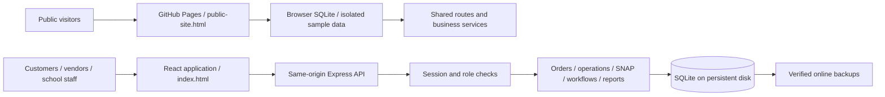

# Application architecture

Qinghe has two deployment targets sharing the full React interface, database schema, routes and business services. The current public target is an interactive demo with automatic sample identities; the Node target retains real session authentication.

## Frontend boundaries

- `src/public-site/` boots the complete app with `src/browser-demo/runtime.ts`. Each visitor gets independent sample identities and an isolated SQLite database in their tab. Orders, inventory edits, school settings, operations and reports remain functional; no credentials or remote API are needed.
- `src/browser-demo/sqlite.ts` adapts the synchronous database interface to `sql.js`; the same migrations, seed and transactional services run in both targets. `router.ts` dispatches the existing route definitions without a network server. Vite aliases these platform boundaries only for the public build.
- Demo mutations are serialized, persisted to `sessionStorage`, and reset from the toolbar. A storage failure leaves current interactions available and shows that refresh will reset them. No real customer data or operating database is included.
- `src/App.tsx` composes the full application shell, authentication, shopping and role navigation. Price charts and school modules load on demand. `src/Prices.tsx` owns price analysis, and `src/Stat.tsx` is shared presentation.
- `src/PageBoundary.tsx` handles loading and module failures with a user-visible recovery action.
- `src/navigation.tsx` centralizes routes and handles a repository subpath through Vite's `BASE_URL`. Public builds emit a document for each available route, so refreshes and new tabs work on Pages.
- `src/MarketVisit.tsx`, `src/MarketGuide.tsx`, `src/marketSchedule.ts` and `references/` own the public market guide. Operational session lookups run against the local demo database in the public build.
- `src/shoppingDraft.ts` stores only the current tab's dated choices, with account checks on restoration; prices and stock always reload. It supports future pickup dates and weighed quantities.
- Browser tests use per-test temporary databases and random local ports through `tests/ui/isolated.ts`.
- `src/api.ts` is the only general API transport. Components do not access the database or receive credentials from build-time environment variables.

## Backend boundaries

- `server/index.mjs` owns process startup, shutdown and the database connection. It drains HTTP requests before closing SQLite.
- `server/config.mjs` validates environment variables and rejects invalid settings before listening. Production requires an explicit database path and defaults to no demo data with secure cookies.
- `server/http-policy.mjs` owns security headers, proxy configuration and browser write-origin checks. `PUBLIC_ORIGIN` allows exact matching behind an HTTPS reverse proxy.
- `server/app.mjs` composes HTTP routes, validation, sessions and role checks.
- `server/services.mjs` owns server pricing, transactional inventory and order state transitions; `operations.mjs` owns sessions, pickup and receipts. `snap.mjs` owns food eligibility and mixed tender estimates.
- `admin.mjs`, `analytics.mjs` and `screen.mjs` compose school reporting. `workflows.mjs` covers vendor applications and market operations. Email notifications use a durable outbox and a separately configured provider.
- `server/db.mjs` creates and migrates SQLite, using foreign keys, WAL and busy timeouts. Migrations must preserve existing orders and price snapshots.

## Deployment and data

The full app is a **single Node.js 24 process with one writable persistent disk**. React assets and the API share an origin. A container's writable layer is not durable storage; `/data` must be a volume. Run one replica while using SQLite; scaling to multiple application replicas requires a coordinated database migration rather than shared container-local files.

Hashed assets receive a year of immutable caching. HTML, account data and API responses use `no-store`. No database, real contact book, `.env`, backup or test artifact belongs in the public repository or Pages artifact.

The public Pages artifact contains the full demo application and versioned reference data. Node infrastructure, secrets and operational databases are not deployed there. The demo creates its sample database locally. Its reference information changes through reviewed source updates; it is not a live closure or inventory feed.

## Verification

`npm run check` type-checks and builds the full application, builds the independent public website and runs the Node regression suite. Browser tests verify role workflows and responsive layouts. Deployment tests exercise exact origin checks behind a proxy, invalid configuration, deep links, cache headers and a WAL-safe database backup. GitHub Actions also builds and starts the Docker image using a named data volume.

Source and deployment now share the public `LucasYanzy/qinghe-market-guide` repository. CI validates the application and container; the Pages workflow checks the demo and deploys its build artifact from `main`. The repository retains both source and earlier website history. Deploying the full backend remains a separate operation. Demo preorders stay in the visitor’s tab and are not sent to real vendors.
