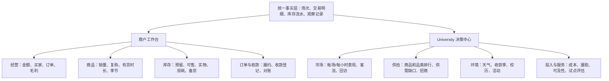

# 青禾经营与 University 决策数据研究

研究日期：2026-11-05（America/New_York）。代码审计基线：`f01e055`，统一仓库 `LucasYanzy/qinghe-market-guide`。

目标是让商户知道卖什么、带多少、何时补货，让 University 知道在哪里、什么时间、以怎样的商品组合和运营投入持续办好市场。**成交额、订单、购买人数、库存和环境因素需要联合分析；两端共享统计口径，按各自的决策任务组织界面。**

这是一份研究与实施规格。文中的指标、界面、数据表和实施阶段为建议，未表示已经接入真实销量、天气、成本或现场客流；演示订单不能用于判断真实 Rutgers 市场表现。全部非 Logo 改动经 PR 审查。

可供实现和验收使用的逐项定义见 [指标字典 CSV](decision-analytics-metrics.csv)。字典中的“现有可派生”表示已有足够的平台字段，仍需开发、校验和标注覆盖范围，并不表示功能已完成。

**后续实施进度（2026-11-05）**：本次可视化实现已增加平台商品去重买家、期间跨场次复购买家、交互排行、市场对比和可核对的图表明细，商户查询由服务端限定本人。第 3 节仍是 `f01e055` 的审计记录；库存流水、实际营业小时、现场销量完整覆盖、成本与天气分析尚未实现，P0–P4 也未因此全部完成。

**交互与经营指标补充（2026-11-05）**：商品支持最多三项对比、按市场与跨场次复购筛选、分页和完整 CSV。详情补充成交均价（完成商品金额 ÷ 实际交付数量）、成交单价范围、每单购买量、有成交的日期数、最近成交日期及同口径上期成交额比较；成交日期不代表真实出摊次数。趋势支持点击与键盘拖动日期检查。

学校新增“经营与覆盖”：平台订单的现金/银行卡/SNAP 收款登记及凭据覆盖率，运营方商户费用的期间收款、到期账单与当前余额，已到日期且未取消场次的出勤和销售填报覆盖率。商品销售属于商户，不能算作运营方收入；自报销售含预购与现场交易，不能与平台金额相加。费用期间收款按美国东部登记日期计算，到期账单余额反映当前记录。缺报显示未知，不按零销售处理。成本、损耗、资助尚未接入，不计算利润与盈亏平衡。本轮按用户最新要求不接天气数据或天气模型。

## 1. 研究依据与适用边界

本次直接核对了农夫市场评估方法、零售报表实例、本地作物季节、官方开市安排、校历和气候数据来源，随后对照现有数据库、服务和页面。

| 来源 | 直接核对到的内容 | 对本项目的启示 |
| --- | --- | --- |
| [S1] Farmers Market Coalition 评估资源库 | 客流计数、顾客调查、商户销售采集是不同的数据采集工具 | 线上订单无法替代现场到访或整体市场销售；按目的设计采集 |
| [S2] Oregon State University，Tools for rapid market assessments，2008，2024 复核 | 低成本客流计数、dot surveys、定性观察；按小时抽样计数；天气和季节影响客流 | 可从志愿者可执行的短时计数和少量问题起步；估算须说明日期、方法、覆盖入口与抽样时段 |
| [S3] Intuit QuickBooks 社区的商品销量报表示例 | 一位生鲜经营者指出单价随季节变动；回复说明按商品报告 Qty、U/M 和金额 | 同时显示销售额、销量和单位；价格上涨不等于需求增长。该资料为 Desktop 社区实例，不据此断言 Online 当前套餐功能 |
| [S4] New Jersey Department of Agriculture / Jersey Fresh | 按月份查作物供应、当周供应和 Seasonality Chart | 地方收获季作为供给背景；实际农场供货和本系统记录优先，季节表不能证明需求或实际有货 |
| [S5] Rutgers 市场运营方 Visit Us | 2026 年各地点开市季、星期、营业时长和例外休市不同 | 跨市场比较须同时显示开市次数和小时数，不能只比较月总单量 |
| [S6] Rutgers Academic Scheduling | 官方校历入口，并提示部分学院校历可能不同 | 学期、考试、假期是校园市场的候选解释因素；按校区、学院适用范围和学年维护 |
| [S7] NOAA NCEI Climate Data Online | 质量控制的日、月、季、年温度、降水、风等数据及 30 年气候常年值 | 区分当天营运天气与长期气候背景；保留站点、缺测、时间范围和单位 |
| [S8] USDA AMS 经济影响评估指南 | 严格的区域经济影响评估需要额外的供应商、顾客和投入产出资料 | 平台销售额可以作为经营指标，不能直接乘一个系数称为经济贡献或减碳成果 |
| [S9] USDA SNAP 农夫市场接受情况页面 | 官方零售商定位器可核查接受 SNAP 的市场 | 接受资格、付款偏好、现场收款登记、实际结算是不同事实，分别记录 |

以上为方法和数据来源，不是本市场效果评估。本文的优先级、界面布局、分析门槛与补货规则属于针对青禾的设计建议；没有将其他市场的效果百分比移植到 Rutgers。

## 2. 两端分工：共享事实，服务不同决策

| 数据领域 | 商户工作台 | University 决策层 |
| --- | --- | --- |
| 成交额、订单、商品排行 | 自家逐菜、逐场、逐渠道明细；核对收入与备货 | 市场、品类和商品汇总；协调品类结构、招商与整体供给 |
| 购买人数与复购 | 自家顾客需求与回购品种 | 市场吸引力、回访、跨市场需求变化；使用汇总人数 |
| 库存与损耗 | 实物、预留、可售、补货、报损、调拨和盘点 | 品类短缺、售罄和浪费的汇总趋势；协调供给，追踪采集覆盖率 |
| 时间 | 下单高峰、取货高峰、售罄时间、备货提前量 | 开市日与营业时长、排班、摊位、交通和活动安排 |
| 季节、天气与校历 | 得到与下一场备货相关的背景和需求区间 | 跨市场趋势、停开市原因、学期与天气关联、长期季节规划 |
| 成本与资金 | 自家成本、毛利、费用、应收及收款；仅在数据齐备时计算 | 市场运营成本、补助、每场投入、服务触达与项目目标 |

University 应保留商品成交额与订单排行，不应把学校端缩减成天气图。商户也需要接收可操作的天气和季节提示。区分的是使用场景和权限，不是把相关因素隔断。

学校服务台代办所需的订单操作权限与决策看板分开。决策看板默认无需顾客姓名、邮箱、备注、卡号或商户私人采购成本。商户查询与导出均由服务端限定自己的 `retailer_id`，不能只在浏览器隐藏其他商户。

### 2.1 用户提供的 QuickBooks 参考图如何转化为需求

参考图能直接看到 Accounting、Expenses & Bills、Sales & Get Paid、Customers、Inventory 等模块，以及利润/亏损和发票卡片。可借鉴的是按实际工作组织入口，并让汇总数字可以追溯到记录。截图本身不能证明任一套餐的当前能力、库存精度或农夫市场适用性。

| 参考模块 | 青禾需要的工作流 | 数据与权限要求 |
| --- | --- | --- |
| 销售与收款 | 预购 → 确认/调整 → 实际交付 → 收款登记 → 退款/对账 | 预购金额、完成金额、已登记收款、实际结算分别展示；销售渠道与付款方式分开 |
| 库存 | 供货 → 预留 → 可售 → 实物交付 → 盘点与损耗 | 有数量、单位、发生时间、原因、经手人和来源；商户看自家，学校看协调供给所需的汇总 |
| 客户与报表 | 哪些菜买家多、复购高，哪些场次需求稳定 | 用已知账号去重和观察窗口；线下匿名交易保留未知；不为报表额外采集敏感身份 |
| 费用与利润 | 商户采购/运输/损耗与每场贡献；学校运营支出、摊位费和资助 | 两套费用主体分别核算，成本完整后才算毛利或净贡献；学校不默认取得商户私人账本 |
| 发票与应收 | 学校核对商户摊位费等账单；商户另核对自己的销售应收 | 现有学校对商户的发票不是商户对顾客的全部收入账，报表不能混合这两种债权 |

工资、税务和完整会计另有申报与账务要求，后续若纳入范围，应先定义与专业财务系统的职责和对账接口。本研究优先落地商品、场次、库存和经营决策所需的最小事实链。

## 3. 当前系统能回答什么

审计位置：`server/analytics.mjs`、`server/admin.mjs`、`server/services.mjs`、`server/operations.mjs`、`server/workflows.mjs`、`server/workflow-schema.mjs`、`server/db.mjs`、`server/app.mjs`、`src/SchoolDashboard.tsx`、`src/schoolReports.ts`。

| 当前事实 | 可用程度 | 尚不能得出的结论 |
| --- | --- | --- |
| 订单有顾客、市场、创建时间、自提日期/时段、状态 | 可计算平台订单的去重购买账号、下单时间、自提预约分布 | 不代表所有到访者、现场交易者或家庭；取消/未完成不代表真实购买 |
| `effective_order_items` 有商品快照、单位、数量、单价和商户 | 可按最终有效明细计算商品销售表现，兼容订单调整 | 没有统一作物分类 ID 时，不能把跨商户的同一种菜自动可靠合并 |
| 学校已有完成交易额、订单、回访、商品排行和自提热力图 | 能保留并加强，不需推翻重做 | 当前商品排行没有逐商品去重买家与复购；热力图不是下单时间图 |
| `products.stock` 是当前数值；预购时扣减、取消时恢复 | 可展示当前可预购库存 | 不是历史实物库存，也不能反推真实售出、损耗或售罄时间 |
| 商品只有当前日期/上架状态、价格历史 | 有历史价格和当前供应快照 | 没有逐场上架/有货时长，不能判断卖得少是缺货还是不受欢迎 |
| `market_sessions` 有计划起止时间、状态与取消标记 | 可连接场次、预约容量及计划日历 | 计划开市不等于实际开市；缺实际起止、提前收摊和完整零销量场次记录 |
| `session_vendors` 有计划、确认、缺席与签到状态 | 可区分已签到商户与仅登记入驻商户 | 签到没有完整离场时间，不能直接计算实际商户营业小时；未签到也不自动等于缺席 |
| `order_receipts` 有现场现金/卡/SNAP 登记和时间 | 可核对已登记收款及到场时间的代理指标 | 手工登记不等于银行到账；录入时间可能晚于实际取货 |
| `vendor_sales_reports` 有逐商户场次总额和交易笔数 | 可作为独立的商户申报序列 | 无逐菜销量，且未定义是否包含平台订单，不能直接相加为市场总额 |
| 发票/付款记录存在 | 可核对系统内已登记的摊位费等应收 | 不是完整商户采购、人工、运输、库存成本或市场运营费用账 |
| 未发现天气、现场客流、库存流水表 | 需要新采集 | 不能给出天气影响百分比、实物售罄率、利润或完整需求预测 |

当前页面以订单自提日期和**查询时的当前状态**统计，后续完成/取消会改写历史结果。系统已经有 `operation_events`，记录下单、确认、取消、核验、调整等操作；并非要从零新增一套日志。但现有报表没有按事件重建历史，事件的录入时间也不总等于业务发生时间。正式运营报表需要标明“截至时间”，核查事件覆盖与旧记录缺口，补充必要的业务时间和不可覆盖的调整版本，再通过事件或报告快照复核。无法还原的旧记录明确标注，不能伪造历史状态。

## 4. “哪种菜受欢迎”应有一组可切换的答案

以 `作物分类 × 商品/规格 × 商户 × 市场 × 实际场次` 为分析单元；跨商户先按经过人工确认的标准作物分类汇总。不同品种、包装、单位、品质和有机属性保留明细。

| 指标 | 定义与口径 | 支持的决策 |
| --- | --- | --- |
| 商品完成交易额 | 最终有效商品数量 × 成交单价，扣除可归属退款/退货；无退款数据时标注“完成订单金额” | 哪些菜贡献收入；商品结构、采购和招商 |
| 去重购买人数 | 期间买过该商品且完成交易的不同顾客账号数；跨商品不可直接相加 | 有多少人买，区分少数大单与广泛需求 |
| 完成订单数 / 购物篮渗透率 | 含该商品的不同完成订单 ÷ 同市场同期间全部完成订单 | 哪些菜是常见必买品；搭配和陈列 |
| 同品同单位销量 | 最终成交净数量，按 lb、颗、袋等各自计算 | 需要带多少货；拆分销量增长和价格变化 |
| 每次有货场次销量 | 净销量 ÷ 有该商品可售记录的实际场次；需显示有货小时 | 控制上架机会差异；识别少上架但卖得快的商品 |
| 期间同品复购 | 在本期 ≥2 个不同市场场次完成同品购买的顾客数 ÷ 本期该商品购买顾客数，同时显示窗口和商品归类层级 | 稳定的重复需求；同一场拆单不算复购，不将期间指标误称为长期留存 |
| 30 天复购队列 | 首次被记录同品购买后，在不同场次且 30 天内再次完成同品购买的人数 ÷ 已有完整 30 天观察期的首购队列人数 | 新品是否留住顾客；新加入者不提前算流失；“首次被记录”不保证现实中的首次购买 |
| 缺货与未满足需求 | 有货时长、售罄时间、缺货提醒订阅、求购或因缺货拒单，分别显示 | 销量被供给限制时，辅助增备货；点击不直接当作成交需求 |
| 售罄率与损耗 | 已售出数量 ÷ 同期可供销售数量；损耗单列，分母需可复核 | 同时控制缺货和浪费；不可由当前 stock 反推 |
| 毛利贡献 | 商品净销售额 − 对应售出商品成本，费用与报损按明确规则单列 | 收入高但采购、运输或损耗高的品种是否值得扩大 |

默认同时显示成交额、去重购买人数、订单数、同单位销量及缺货标记，允许按列排序。按收入做 ABC 分组可以辅助管理注意力，但不自动淘汰 C 类：低价基础菜、新品、季节限定和服务目标商品需要保留判断空间。没有成本不能称“利润排行”。

商品榜需有“记录覆盖”列：线上逐单明细、现场逐单/逐菜记录、商户汇总申报分开。没有现场明细的商品只能标“平台已记录需求”，不能宣称是全市场最受欢迎。

### 4.1 防止排行失真的共同约定

- **完成与净额分开命名**：当前可计算“完成订单金额”，用有效明细的正数量逐行按分取整后汇总，与订单最终金额对账。接入折扣、税、退款后再按统一分摊规则生成商品净销售额；纯金额退款不自动减少实物销量，实物退货也不等于已经退款。原订单、调整、退货和退款通过关联键追溯，不重复扣减。
- **商品层级可解释**：同时保留原商品 ID/名称快照与标准作物 ID；同作物的不同品种、规格和单位可按需展开。金额、不同订单和买家可以去重汇总；未知净重的“袋”与“磅”不能相加，跨商品买家也不能相加。旧商品的分类映射按版本保留，避免改名或重新上架使历史排行漂移。
- **同一场次的拆单去重**：订单仍按真实订单数计；商品买家按账号计；复购按不同场次计。缺历史场次 ID 时仅在明确每市场每天一场的范围内用“市场 + 自提日期”作为代理，并标注。多个商户订单不等于多次到访，未知身份现场交易不进入买家和复购分母。
- **渗透率有两个问题**：“占全部已记录购物篮多少”用同渠道完成订单作分母；“有货时有多少人选它”仅在匹配的可售时间/场次内计算。后者需要有货历史。两个指标分别命名，不用订单占比冒充看到商品后的转化率。
- **零、缺失与分母分开**：正常开市且记录完整的零销量必须进入每场平均；取消场次、缺记录场次另列。分母为零返回无数据，不能显示 0%。排行与环比同时给出场次数、已知身份覆盖和渠道覆盖；覆盖率未知就显示未知，不能用平台金额占未知市场总额计算。

库存采集先验收数量守恒：**期初实物 + 到货 + 调入 + 实际可复售退货 + 盘盈 = 实物交付 + 报损 + 捐赠 + 调出 + 期末实物 + 盘亏**。预约预留只是实物中的承诺量，不进入收支两边。售罄率按相同商品、单位、供货批次/场次计算净售出占可供量；同批退货不重复增加分母，跨期退货与转存需归回来源或单列，不能混成一个无来源的比率。库存调整须记录原因，不能用调账掩盖损耗。

## 5. “什么时候买得多”至少有三条时间轴

1. **下单时间**：按 `created_at` 从明确的 UTC 时间转换到 America/New_York，按星期 × 小时统计下单；用于提醒、发布商品和处理订单。订单日期范围与自提日期范围分别筛选，避免将“本周来取”的订单错当“本周下的单”。
2. **到场/成交时间**：优先用实际核验或销售发生时间；收款登记时间只能作为有标签的代理值。用于高峰排班、排队和摊位配置。
3. **供货时间**：到货、上架、预留、实物售出、缺货、补货和下架时间；用于提前量和备货。预约时段不证明人何时真正到场。

跨市场保留总订单、完成订单、去重买家和交易额，同时增加每实际场次、每营业小时、每到场商户小时的比率，显示样本数与渠道覆盖。

**示例仅说明计算，不是实测**：A 市场开 10 场、共 50 小时、200 单；B 开 2 场、共 8 小时、80 单。A 总单更多；B 为 40 单/场、10 单/小时，A 为 20 单/场、4 单/小时。两种信息都保留，不能只给一个“受欢迎指数”。缺客流时不称到访转化率；缺实际开市记录时不以有订单的日期代替全部开市日。

## 6. 季节性：同时研究供给、需求和校园节奏

三层数据要并列：

- **供给季节**：Jersey Fresh 本地供应参考 + 农场实际可供日期/数量、品质、储存货或温室货标记。参考日历有版本和核对日期。
- **购买季节**：同一标准作物、单位、市场的逐场销售、买家、渗透率、价格、促销和有货时长。按年-月与周展示，不把不同年份的同月直接混为一个数据点。
- **校园季节**：学期周次、考试、假期、迎新/活动、校园人口活动的可核实代理指标。对 College Ave 等校园市场尤其重要，不假设所有社区市场同样受影响。

“秋天番茄卖得少”可能是收获季结束、断货、关市、价格升高、学生离校、渠道漏记或偏好变化。先核对这些因素，再解释需求。

第一年提供观测趋势和同比不可用状态。积累多个可比季后，可在同市场、同品、同星期及学期阶段内比较每有货营业小时的销量与购买渗透率，并展示覆盖率、范围和价格变化。至少两个季节是形成同比的起点，**不是足以识别稳定季节规律的保证**。

季节性强的商品不能直接用全年平均日销量备货。新品、断货日和休市日须分别标记；缺记录不是零销量，正常开市但无人购买才是有效的零。

## 7. 天气与气候：University 的环境决策模块

近期营运主要研究天气，长期基础设施规划才研究气候常年值和极端事件背景。

| 内容 | 应记录的变量 | 可用于的决策 |
| --- | --- | --- |
| 营业时段天气 | 温度、降水、阵风；有条件时体感/热指数，明确实测与预报 | 雨棚、遮阳、室内备选、志愿者排班、通知 |
| 极端天气与运营结果 | 预警、取消/提前结束原因、计划与实际营业小时 | 应急安排与损失记录；不得以销量模型代替安全判断 |
| 农业供给背景 | 农场实际供货变化、干旱/热浪等有来源记录 | 调整招商、替代品类和预期供应 |
| 长期气候背景 | NOAA 常年值、历史极端事件、适用站点 | 选址、遮蔽设施和营业季评估，不直接套用短期销量回归 |

天气记录保存市场位置、站点/网格、观测区间、来源、抓取时间、单位、质量/缺测标记；优先营业小时数据，全天降雨可能仅发生在夜间。先核实所选 NOAA 数据产品、站点、字段和小时覆盖；本次只核对 CDO 数据入口，未确认本地小时序列完整可用。只有日数据时明确标注粒度，不补造营业小时天气。预报必须保存发布时刻及有效时段，不能将事后实测值当作当时已知信息。

分析流程：先按市场、星期、月份/学期、营业时长、实际到场商户、供货和促销分层，再比较雨天/非雨天、不同温度组的每场订单、客流和交易额。报告同时给出组内场次数、覆盖率、中位数/分布及差值；小样本仅为观察。停市场次单独统计，不能只保留雨天仍开市的场次而忽略取消造成的影响。

这是关联分析，不能写“下雨造成销量下降 X%”或自动建议减货 X%。若要检验雨棚、延长时间或新地点的效果，预先登记试点、可比对照、主要指标和评估窗口，控制季节/活动等共同变化。

## 8. 可持续经营需要一起看的结果

| 结果领域 | 商户 | University |
| --- | --- | --- |
| 经营可持续 | 净销售、毛利、损耗、每场净贡献、复购、补货满足率 | 参与商户留存、每商户场次销售中位数、市场运营成本与摊位费/资助，分渠道覆盖 |
| 供需匹配 | 有货但滞销、早售罄、预购取消原因、替代接受率 | 品类空缺、重复供给、需求未满足、摊位组合与容量 |
| 食品可及 | 基础菜的可比单价和可供量；不要求采集顾客敏感资格 | 可负担商品篮价格、已记录 SNAP 收款/核销、项目触达、公开交通便利性、适用人群的自愿调查 |
| 食物损耗 | 售出、折价、捐赠、报损、转存分别计量 | 按可换算重量和去向汇总，评价减少浪费的实际进展 |
| 社区参与 | 真实反馈与复购 | 客流、回访、满意/未买原因、社区反馈；订单账号不是居民人数 |

交易额不等于利润或区域新增经济效益。捐赠不能记作售出；未记录重量不把袋/颗数换算成吨，也不据此估算减碳。目标之间可能有取舍：保障低价基础菜和食品可及性时，不能只追求最高销售额或最低补助/单。

## 9. 从数据到操作：规则必须能解释

| 联合信号 | 可执行动作 | 复查依据 |
| --- | --- | --- |
| 买家多、复购高、经常早售罄，损耗低 | 商户小步增加下次同类场次备货；学校协调同类供货 | 有货时长、未满足需求、同星期/季节、价格，不能直接按售罄数量推断全部需求 |
| 成交额高、购买人数少 | 核查高单价/大单，保证重点客户供给，同时保留基础品类 | 人数与订单分布、毛利、订单集中度 |
| 成交额增长但同单位销量不增 | 区分单价、规格或商品组合变化 | 商品快照、折扣、净销量；不称需求强劲增长 |
| 买家多但毛利低、报损高 | 调整订货频率、运输/储存和价格策略 | 成本与损耗完整后再评价；学校可评估公共服务必要性 |
| 库存多、买家少、曝光/供应记录不足 | 先核对上架、位置、可达性和品种识别，做小规模陈列或价格试验 | 不能只凭一场低销量下架 |
| 总订单少、每营业小时订单高且排队长 | University 评估增加时长、场次或服务台能力 | 实际小时、到场客流、等待时间、额外成本，保留试点和对照 |
| 下雨时客流减少但预购履约稳定 | 评估遮雨与快捷取货，调整到场服务安排 | 分开现场客流、预购、取消和闭市记录 |
| 某市场订单增长、填报覆盖也增长 | 先确认增长来自真实需求还是补录/渠道接入 | 数据发生时间、录入时间、导入批次与覆盖率 |

建议补货量应展示计算依据与区间：相似场次可供货期间的需求基线 + 已确定承诺/安全余量 − 可用实物库存 − 已确定到货，并说明基线是否包含已承诺订单以防重复加算。受保鲜期、采购提前量和运输约束；由商户确认，不自动改库存或采购。

## 10. 最小采集方案：先让记录可持续

**每次交易自动记录**：渠道、不可重复的外部/内部交易 ID、发生时间和录入时间、市场/场次、商户、商品快照、标准作物 ID、单位、数量、折扣、最终金额、退款/退货、订单与核验/收款关联。没有可识别顾客的线下交易保留为“身份未知交易”，不能虚构独立顾客。

**每场商户收摊**：期初实物量、补货/调入、售出、捐赠/报损/转出、期末盘点，按商品与单位；允许保存草稿、批量填报和学校代办。初期优先常售品种，显示覆盖程度，不强迫一开始做全部财务核算。

**每场管理记录**：实际开始/结束、是否取消/提前闭市及原因、实际到场商户数、客流采集方法和时段、活动/促销、备注；天气按来源导入，校历由学校按学年维护。

参考 [S2]，志愿者可以采用每小时固定 10 或 20 分钟入口计数；按方法换算估计客流并保留原始计数、覆盖入口、遗漏、重复进入处理和方法版本。不能将抽样估算标为准确去重人数。现场问卷每次聚焦少量问题：想买但没买到什么、来访频率、未购买原因、到达便利性。问卷答案与真实购买分别显示。

**收款与商户总额去重**：申报表必须声明“含平台/不含平台/未知”、包含的渠道、税/退款口径和覆盖时段。含平台申报总额与平台订单用于对账，不能相加；只有已验证互斥的部分才能合并。统一现金、银行卡、SNAP 付款方式与销售渠道两个维度；付款方式不是渠道。

覆盖程度分别报告，不能混为一个百分比：①已申报商户场次 ÷ 已核实实际到场商户场次；②有完整商品实物记录的商户场次 ÷ 已核实实际到场商户场次；③有身份的逐笔交易 ÷ 全部已记录逐笔交易。第三项仅描述记录内的身份覆盖，前两项也不证明销售额已覆盖同样比例。未完成实际到场登记时，覆盖率分母仍然未知。

## 11. 页面建议

商户首页优先“下一场要准备什么”：已承诺数量、库存风险、同类场次需求及待处理订单；深度报表按需展开。University 首页优先“需要做什么决定”：场次比较、供给缺口、环境变化和待验证试点。保留向下钻取，避免所有指标挤在首页。

所有报表带市场、日期、场次、渠道、单位与数据更新时间；可查看“为什么得到这个数”。缺数据、零、未知、估算和样本不足有不同状态。CSV 导出沿用相同筛选、口径与角色权限，附发生日期/自提日期的选择和来源覆盖说明。低性能设备默认静态表格、轻量图形，气候或长周期分析按需加载。

## 12. 建议的 PR 顺序与验收

| 阶段 | 交付 | 验收重点 |
| --- | --- | --- |
| P0：统一口径与历史事实 | 指标字典、渠道与申报覆盖标记、商品标准分类、复用并补齐事件与历史快照 | 订单调整/取消/退款不重复计；标准菜和规格不误合并；商户隔离；历史可复核或明确缺口 |
| P1：立即有用的两端报表 | 金额/买家/订单/渗透率/同单位销量、期间复购；下单与自提时间分开；University 保留商品汇总 | 2 笔同人订单算 1 买家；零分母返回无数据；市场/日期/渠道/角色筛选一致；标明仅平台覆盖 |
| P2：库存和场次真实采集 | 库存流水、物理盘点、实际场次与客流、销售申报对账 | 预留不等于实物售出；取消释放预留；实际开市零销量可表示；缺记录不当作零 |
| P3：天气、季节和校历 | NOAA 等来源接入、Jersey Fresh 版本化参考、学校校历、分层比较 | 天气缺测/休市保留；时区和夏令时正确；同年月份与跨年区分；小样本不输出因果结论 |
| P4：备货与运营试点 | 可解释的需求区间、商户确认备货、雨棚/时段等试点评估 | 滚动时间回测优于简单基线后再启用；不使用未来天气实测或未发生订单；保留建议与结果 |

P1 可使用已有平台订单先提供有限范围的实用分析，不等待全部外部系统。P2 同时建立未来季节研究需要的历史。每个阶段单独 PR；不因本研究自动发布、修改真实库存或给商户发送建议。

**建议的最小试点**：先选一个市场的一组自愿参与商户，使用现有平台订单并增加逐场供货、收摊、实际时段与渠道声明。每场核对订单明细金额与订单合计，检查实物守恒、申报重叠和记录耗时；每次复盘只选一个具体决策，例如常售菜的下一场备货或取货台排班。记录采取了什么动作、同类场次背景以及售罄、损耗、买家/小时和服务等待的变化。试点先验收可持续填报与数字可复核，再推广；若仅观察到前后变化，不称为干预的因果效果。

P1 的典型验收例：同人同场两单算两订单、一买家、一次购买场次；已接受调整后数量为零的商品不贡献买家或销量；市场开四场但只在三场有订单时，第四场只有在核实开市且记录完整后才能计零；现场申报标“含平台”时总额不与平台相加；未知单位保持独立；两次纽约本地时间 01:30 的夏令时回拨记录保留 UTC/时区偏移，日内小时汇总按标明的规则合并或展开。

需求预测优先采用可解释的相似场次/季节朴素基线；按时间前推回测，不随机打散历史。每个同单位商品报告 MAE，实际销量合计非零时再报告 WAPE；强断货记录须单列，不能把观测销售当作未受约束的需求。没有足够历史时展示“正在积累”，不给伪精确的百分比或最优库存。

## 13. 研究结论

优先把“商品成交额 + 去重购买人数 + 同单位销量 + 有货机会”“市场总订单 + 每实际场次/小时表现”“天气 + 收获季 + 校历 + 供货情况”做成可联动的分析，再扩展成本和预测。**市场持续发展同时需要商户能持续经营、顾客买得到需要的菜、University 能合理分配运营资源；单一成交额或订单榜不能代表这三个目标。**

### 来源索引（本次直接打开核对）

- [S1] Farmers Market Coalition，[Resource Library — Collecting Data](https://farmersmarketevaluation.org/resource-library/?_sft_resource_cat=collecting-data-methods-and-implementation)。用于核对工具分类，未声称已下载其中全部 PDF。
- [S2] Oregon State University Extension，[Tools for rapid market assessments](https://extension.oregonstate.edu/catalog/pub/sr-1088-tools-rapid-market-assessments)，SR 1088，Published May 2008，Reviewed 2024。已阅读网页的计数、dot surveys 和方法说明。
- [S3] Intuit QuickBooks Community，[Sales Report of Items by VOLUME](https://quickbooks.intuit.com/community/reports-and-accounting-5/sales-report-of-items-by-volume-41247)。已阅读问题与回复；不将搜索引擎 AI 摘要作为依据。
- [S4] New Jersey Department of Agriculture，[Jersey Fresh Availability](https://findjerseyfresh.com/JerseyFresh/availability)。已核对按月筛选、当周供应和季节图入口，未将其外推为农场当前库存。
- [S5] Rutgers Community Farmers Market，[Visit Us](https://communityfarmersmarket.rutgers.edu/visit-us/)。本次可见 2026 年安排；不据此推算 2027 年。
- [S6] Rutgers Office of Academic Scheduling and Instructional Space，[Academic Calendar](https://scheduling.rutgers.edu/academic-calendar/)。已核对官方入口和学院差异提示；本研究未逐项导入学期日程。
- [S7] NOAA NCEI，[Climate Data Online](https://www.ncei.noaa.gov/cdo-web/)。已核对数据种类、质量控制与站点检索说明；未下载本地时序或拟合天气效应。
- [S8] USDA Agricultural Marketing Service，[Practitioner’s Guide to Conducting an Economic Impact](https://www.ams.usda.gov/reports/practitioner%E2%80%99s-guide-conducting-economic-impact)，2016-07-29。已阅读说明页，未声称完成 IMPLAN 评估。
- [S9] USDA，[Farmers Markets Accepting SNAP Benefits](https://www.fna.usda.gov/snap/farmers-markets-accepting-benefits)（从 `fns.usda.gov` 官方原链接重定向）。已核对接受情况查询用途；不作为本市场已授权或已结算的证据。

### 2026-11-05：付款与补助分类

按用户提供的报表列，商户整场销售填报新增 Cash、Credit、Check、SNAP、Good Food Bucks、Market Bucks、QR Code（WIC & FMNP）和 Match 八类。分类属于商户申报销售的拆分，不与平台订单收款、运营费用再相加。保留平台凭据中原有“银行卡”的口径，不把历史未区分的银行卡记录冒称为 Credit。

- 金额以整数美分存储，启用分类时要求完整八项、非负整数，合计必须等于总销售额。每一美元只归入一个类别；Match 仅表示已经用于购买、且未计入其他类别的配比补助，未消费额度不属于销售。QR Code 仅汇总 WIC / FMNP，不代表普通二维码付款。
- 旧报告保留总额，分类存 NULL，不能填造零。统计单列已分类与未分类销售额、已分类报告数；占比仅以已分类销售为分母。显式全零报告与缺报有区别。
- 商户查看和修改自己的报告，管理员可代录。沿用签到、已到营业日期、未取消场次与版本校验；切换商户或场次后重新加载当前报告。
- 新增迁移保留旧数据；历史客户端不传分类时，总额不变可保留已知分类，总额变化则清除失效分类。
- 分类录入不代表计划受理资质、银行结算、在线扣款或运营方资助收入；本轮不接天气数据与模型。
